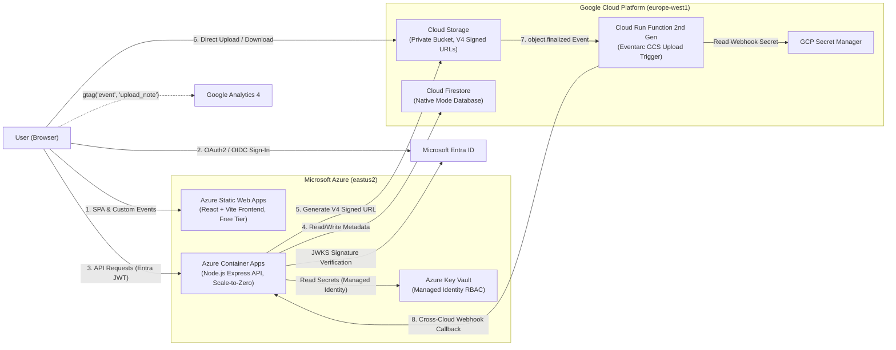

# StudyVault — Multi-Cloud Lecture Notes & Document Hub

**StudyVault** is a complete multi-cloud web application built on **Microsoft Azure** and **Google Cloud Platform (GCP)**. Students sign in with **Microsoft Entra ID**, upload PDF or plain-text lecture notes into a **private Google Cloud Storage** bucket via short-lived V4 Signed URLs, and a **GCP Cloud Run Function (2nd Gen)** automatically triggers on upload to extract page count, word count, and a text summary before calling back the **Azure Container Apps** API to update **Cloud Firestore**.

> **Demo Video (≤ 10 min):** _[Add unlisted YouTube / Google Drive / OneDrive link here before submission]_

---

## 1. Architecture Diagram



### Live Endpoints
- **Frontend (Azure Static Web Apps):** `https://jolly-rock-0fe27580f.5.azurestaticapps.net`
- **Backend API (Azure Container Apps):** `https://ca-studyvault-api.whitebush-c7fb068c.eastus2.azurecontainerapps.io`
- **Health Check:** `GET /health`

---

## 2. Cloud Placement & Rationale

| Mandatory Component | Service Used | Cloud | Why This Cloud? |
|---|---|---|---|
| **Authentication** | Microsoft Entra ID (MSAL.js + Backend JWKS JWT validation) | Azure | Mandatory identity provider; native integration with Azure ecosystem. |
| **Web Interface** | Azure Static Web Apps (Free Tier) | Azure | Global HTTPS CDN at \$0/month; ideal for React/Vite SPA with zero server maintenance. |
| **Backend API** | Azure Container Apps (`min_replicas = 0`) | Azure | Serverless containers that scale to zero; uses System-Assigned Managed Identity for Key Vault access and free GHCR (`ghcr.io`) for container images. |
| **Secrets (Azure)** | Azure Key Vault (RBAC) | Azure | Stores cross-cloud GCP Service Account key and webhook secret; zero plaintext secrets in app settings or repo. |
| **Database** | Cloud Firestore (Native Mode) | GCP | Serverless NoSQL database with generous free tier (1 GiB storage, 50k reads/day) and zero idle cost. |
| **Object Storage** | Google Cloud Storage (`public_access_prevention = enforced`) | GCP | Strictly private bucket accessed only via short-lived V4 Signed URLs generated by the Azure Backend. |
| **Serverless Function** | Cloud Run Functions 2nd Gen (Eventarc `object.finalized`) | GCP | Event-driven PDF/TXT metadata & summary extractor triggered automatically on every file upload to GCS; scales to zero. |
| **Secrets (GCP)** | GCP Secret Manager | GCP | Stores the shared cross-cloud webhook secret mounted directly into the Cloud Run Function runtime. |
| **Analytics** | Google Analytics 4 (`G-GCBYW9B8RG`) | Google | Tracks page views and custom events (`login_entra`, `upload_note`, `download_note`, `delete_note`). |
| **IaC & Remote State** | Terraform (`infra/gcp`, `infra/azure`) + GCS Backend | GCP & Azure | All cloud resources across both providers are declaratively managed with versioned remote state in GCS. |
| **CI/CD** | GitHub Actions + OIDC (GCP WIF + Azure Federated Credentials) | GitHub | PRs run tests + `terraform plan`; merges to `main` apply Terraform and deploy all apps with zero static cloud keys. |

### Cross-Cloud Communication
1. **Azure -> GCP:** The Node.js API on **Azure Container Apps** authenticates to **GCP** using a least-privilege Service Account key fetched at startup from **Azure Key Vault** (via Managed Identity), reads/writes note metadata in **GCP Firestore**, and signs V4 PUT/GET URLs for the private **GCS** bucket.
2. **GCP -> Azure:** When a file lands in private **GCS**, Eventarc triggers the **GCP Cloud Run Function**, which parses the PDF/TXT, reads the shared webhook secret from **GCP Secret Manager**, and sends a `POST /api/internal/notes/:id/processed` callback to the **Azure Container Apps** API.

---

## 3. Repository Structure

```text
.
├── backend/                   # Node.js + Express + TypeScript API, unit tests, Dockerfile
├── frontend/                  # React + Vite + TypeScript SPA (MSAL.js + GA4)
├── function/                  # GCP Cloud Run Function (Node.js + unpdf) & unit tests
├── infra/
│   ├── gcp/                   # GCP Terraform stack (GCS, Firestore, Function, Secret Manager, WIF)
│   └── azure/                 # Azure Terraform stack (Resource Group, Key Vault, Container Apps, SWA)
└── .github/workflows/
    ├── ci-pr.yml              # Pull Request: typecheck, build, unit tests + Terraform Plan (OIDC)
    └── cd-main.yml            # Merge to main: Docker build/push (GHCR) + Terraform Apply + Deploy (OIDC)
```

---

## 4. Manually Created Bootstrap Resources (Justified)

All application cloud resources are created and destroyed with Terraform. Only the minimal one-time bootstrap items that cannot self-bootstrap or live outside Terraform providers were created manually:

1. **\$5 Budget Alerts on GCP & Azure:** Created before provisioning any infrastructure as a cost safety guardrail.
2. **GCP Project (`studyvault-cloud-2026`) & Terraform Remote State Bucket (`studyvault-tfstate-700696007423`):** Required to exist before `terraform init` can store remote state for both stacks.
3. **Microsoft Entra ID App Registration (`StudyVault Web App`) & Azure OIDC App (`StudyVault GitHub Actions OIDC`):** Bootstrap identity registrations needed so GitHub Actions can authenticate via OIDC without static secrets and users can sign in with Entra ID.
4. **Google Analytics 4 Property (`G-GCBYW9B8RG`):** Created in the Google Analytics console (no standard cloud IaC provider).

---

## 5. How to Deploy

### Prerequisites
- `terraform >= 1.6`, `gcloud`, `az`, `node >= 22`
- Authenticated `gcloud auth application-default login` and `az login`

### Manual Deployment (Terraform)
```bash
# 1. Deploy GCP stack (private GCS, Firestore, Secret Manager, Cloud Run Function, GitHub OIDC)
cd infra/gcp
terraform init
terraform apply

# 2. Deploy Azure stack (reads GCP outputs from remote state, populates Key Vault, creates Container Apps & SWA)
cd ../azure
terraform init
terraform apply

# 3. Sync live Azure API URL & SWA CORS origin back to GCP
cd ../gcp
terraform apply \
  -var="azure_api_url=$(cd ../azure && terraform output -raw api_url)" \
  -var="allowed_cors_origins=[\"$(cd ../azure && terraform output -raw frontend_url)\",\"http://localhost:5173\"]"
```

### Automated Deployment (CI/CD via GitHub Actions + OIDC)
- **Pull Request to `main`:** Automatically runs [`ci-pr.yml`](.github/workflows/ci-pr.yml) — backend/function/frontend builds & tests + `terraform plan` on both GCP and Azure via OIDC.
- **Merge to `main`:** Automatically runs [`cd-main.yml`](.github/workflows/cd-main.yml) — builds and pushes the backend Docker image to `ghcr.io`, runs `terraform apply` on both clouds, syncs cross-cloud webhook/CORS settings, and deploys the React frontend to Azure Static Web Apps.

### Teardown (Cost Hygiene)
```bash
cd infra/azure && terraform destroy
cd ../gcp && terraform destroy
```

---

## 6. Cost Estimate & Actual Cost

All services were selected for **free tiers** and **scale-to-zero** behavior (no NAT gateways, no AKS/EKS, no always-on VMs):

| Service | Tier / Configuration | Estimated Monthly Cost |
|---|---|---|
| Azure Static Web Apps | Free tier | \$0.00 |
| Azure Container Apps | Consumption, `min_replicas = 0` (180k vCPU-s free grant) | \$0.00 |
| Azure Key Vault | Standard (~2 secrets, <1k ops) | ~\$0.01 |
| Microsoft Entra ID | Free tier | \$0.00 |
| GCP Cloud Storage (Private) | <1 GB, minimal ops (covered by free tier / \$300 credit) | \$0.00 |
| GCP Cloud Firestore | Native mode free tier (1 GiB, 50k reads/day) | \$0.00 |
| GCP Cloud Run Function 2nd Gen | `min_instance_count = 0` (2M free invocations/mo) | \$0.00 |
| GCP Secret Manager | 1 active secret version (6 free versions/mo) | \$0.00 |
| GitHub Container Registry (`ghcr.io`) | Public package | \$0.00 |
| **Total Estimated Cost** | | **~\$0.01 / month (well under \$30 limit)** |

### Actual Cost Screenshots
> _[Add Azure Cost Management and GCP Billing screenshots here before final submission]_

---

## 7. Team Contribution

- **Halit Dündar (Solo Project):** Full multi-cloud architecture design, React + Entra ID + GA4 frontend, Node.js + Key Vault + Firestore/GCS backend API, event-driven GCP Cloud Run Function, GCP & Azure Terraform stacks with remote state, GitHub Actions OIDC CI/CD pipelines, testing, and documentation.
